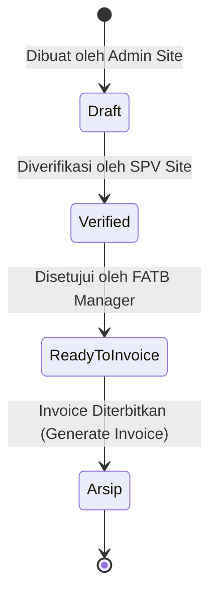
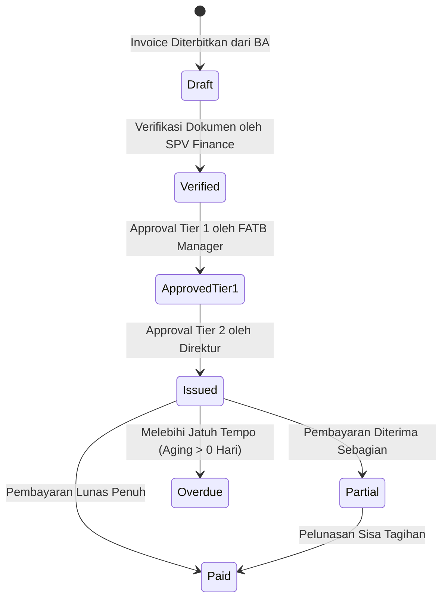

# Product Requirements Document (PRD) & Technical Architecture Specification
## Modul Finance, Master Data & Billing Engine (FE-EFMS & BE-FEMS)

**Versi Dokumen**: 1.0.0  
**Target Sistem**: PT Andalan Artha Primanusa (AAP) — Mining Contractor ERP  
**Karakteristik Operasional**: Multi-Site Mining (BGG Batubara, POS Nikel, DBK, SBS)  
**Tujuan Dokumen**: Dokumen acuan lengkap (*Single Source of Truth*) mengenai seluruh alur kerja, logika kalkulasi, arsitektur data, alur persetujuan (*approval lifecycle*), dan antarmuka UI/UX pada modul Finance dan Master Data.

---

## 1. Executive Summary & Visi Sistem

Sistem ini adalah **Order-to-Cash (O2C) Finance & Mining Billing Engine** yang dirancang untuk mengotomatiskan penagihan jasa kontraktor penambangan dari hulu ke hilir:

```
[ Joint Survey Site ] 
         ↓
[ Berita Acara (BA) Tracker (4 Steps) ] 
         ↓
[ Billing / Invoice Generator (Multi-Site Formula) ] 
         ↓
[ Payment & Treasury Settlement ] 
         ↓
[ Automated Accounting Engine / General Ledger ]
```

### Problem Statement yang Diselesaikan:
1. **Karakteristik Tiap Site Berbeda**: Klien nikel (POS) memiliki skema pemisahan faktur ganda (*Dual Invoice*), sedangkan klien batubara (BGG) menggunakan penyesuaian harga pasar indeks batubara (*Multi-Tier Coal Indexing*) dan batasan kuota *Stripping Ratio* ($3.0 : 1$).
2. **Rekonsiliasi Volume Lapangan**: Selisih volume antara tim survei AAP dan tim survei Klien harus terekonsiliasi otomatis dengan batas toleransi ($\le 0,5\%$).
3. **Kepatuhan Pajak & Perhitungan Kas Bersih**: Otomatisasi perhitungan DPP, PPN 11%/12%, PPh 23 (2% sebagai kredit pajak), pemotongan solar/BBM (*fuel deduction*), dan proyeksi tanggal jatuh tempo berbasis *credit terms*.

---

## 2. Modul Master Data: "Client Setup" (Site Configuration Hub)

Menu **`Client Setup`** (sebelumnya *Customer Master & Credit Terms*) adalah pusat konfigurasi terpadu untuk seluruh aturan kontrak, tarif material, formula penagihan khusus, dan rekening penerima.

### 2.1 Struktur Entitas Klien & Karakteristik Site

| Site / Klien | Komoditas | Lokasi Pit | Skema Penagihan Utama |
|---|---|---|---|
| **POS (Paramitha)** | Nikel | Pit WM1 | **Dual-Invoice Scheme**: 1 BA menghasilkan 2 Faktur terpisah (*Operation & Mining* dan *MDO*), parameter Overhaul 1.000 m. |
| **BGG (Budi Gema Gempita)** | Batubara | Pit KKL | **Multi-Tier Coal Index ($R3$)** + **Batas Kuota SR 3:1 (Pending Volume)** + **Raise & Fall BBM ($RF$)**. |
| **DBK (Petrosea)** | Batubara | - | **Dual Currency**: Tagihan dalam mata uang USD & IDR. |
| **SBS (Satria Bahana Sarana)** | Batubara | - | Kontrak jasa penunjang & Overburden sub-contracting. |
| **ABN (Andalan Bhumi)** | Afiliasi | - | Entitas hubungan istimewa (*Related Party*). |

---

### 2.2 Komponen Konfigurasi di Client Setup

#### A. Profil & Legalitas Kontrak
- `Customer Code` (*Unique identifier*, mis. `POS`, `BGG`).
- `Full Name` & `Group Parent` (mis. Petrindo Jaya Kreasi Tbk, Paramitha Group).
- `Termin Hari` (*Credit Terms*): Menentukan tanggal jatuh tempo invoice ($\text{Due Date} = \text{Invoice Date} + \text{Termin Days}$).
- `Nomor Kontrak` & `Nilai Plafon Kontrak`.
- `PIC AR Client` (Nama, Telepon, Email Penagihan).

#### B. Katalog SOW (Scope of Work) & Tarif Material
Daftar material pekerjaan per site:
- **Satuan Kerja**: `BCM` (Overburden/Waste), `Ton` (Batubara/Nikel), `LCM`, `WMT`, `Bcm.Hm` (Over Distance), `Meter` (Hauling/Road).
- **Tarif Baseline**: Tarif acuan rupiah per satuan volume.
- **Tarif Multi-Tier (Khusus Batubara BGG)**:
  - **Tier 1**: Indeks Batubara $R3 \le \$45,00/\text{Ton}$
  - **Tier 2**: Indeks Batubara $\$45,00 < R3 \le \$70,00/\text{Ton}$
  - **Tier 3**: Indeks Batubara $R3 > \$70,00/\text{Ton}$

#### C. Formula Penagihan Khusus Site
1. **Aturan Khusus Site POS (Nikel)**:
   - *Faktur 1 (Mining & Operations)*: Top Soil, Limonite, Saprolite, Waste/Overburden, Overhaul.
   - *Faktur 2 (Mine Development / MDO)*: Land Clearing, Grubbing, Water Management, Road Hauling.
   - *Rumus Overhaul Distance*:
     $$\text{Subtotal Overhaul} = \text{Volume (BCM)} \times \left(\frac{\text{Jarak Aktual} - 1.000}{100}\right) \times \text{Tarif SOW}$$
2. **Aturan Khusus Site BGG (Batubara)**:
   - *Kalkulasi Indeks Batubara Bulanan ($R3$)*: Mengambil rata-rata mingguan indeks ICI3 & ICI4 untuk menetapkan Tier aktif.
   - *Batasan Kuota Stripping Ratio (SR 3:1)*:
     $$\text{Kuota Maksimal OB} = 3,0 \times \text{Volume Batubara (Ton)}$$
     - Jika $\text{Volume OB Aktual} \le \text{Kuota}$: Seluruh volume OB ditagihkan pada invoice berjalan.
     - Jika $\text{Volume OB Aktual} > \text{Kuota}$: Volume ditagihkan dibatasi sebesar Kuota; kelebihannya ($\Delta \text{OB}$) dialokasikan ke **Pending Volume Ledger (Carry-Forward)**.
     - Pada periode berikutnya ketika terjadi surplus kuota (*headroom*), saldo *Pending Volume* otomatis diserap (*absorbed*).
   - *Formula Eskalasi Raise & Fall ($RF$)*:
     $$RF = A \left(\frac{F_n}{F_o}\right) + B \left(\frac{L_n}{L_o}\right) + C$$
     - $A, B, C$: Bobot Kontrak ($A = 25\%$ BBM, $B = 15\%$ Tenaga Kerja, $C = 60\%$ Biaya Tetap).
     - $F_n, F_o$: Harga Solar Aktual vs Baseline Kontrak.
     - $L_n, L_o$: UMK/Upah Aktual vs Baseline Kontrak.

---

## 3. Modul Berita Acara (BA) Tracker

Modul **Berita Acara (BA) Tracker** mengelola siklus rekonsiliasi volume hasil kerja penambangan sebelum dokumen resmi diterbitkan.

```
[ Step 1: Input SOW & Volume ] → [ Step 2: Joint Survey ] → [ Step 3: Sign-Off ] → [ Step 4: Audit Trail ]
```

### 3.1 Alur 4-Langkah (4-Step Stepper Wizard)

#### Step 1: Input Pekerjaan & Volume Awal (Site Entry)
- User memilih **Customer** (`POS`, `BGG`, dll) dan **Periode Kerja** (Bulan & Tahun).
- Sistem otomatis memuat daftar item material SOW sesuai template site.
- User menginput volume estimasi lapangan & tarif acuan untuk menghitung nilai estimasi awal klaim (*Unbilled Revenue*).

#### Step 2: Rekonsiliasi Joint Survey & Lapangan
- Input hasil pengukuran survei topografi: `Volume AAP` vs `Volume Client`.
- **Validasi Toleransi Otomatis**:
  $$\text{Selisih (\%)} = \left| \frac{\text{Volume AAP} - \text{Volume Client}}{\text{Volume AAP}} \right| \times 100\%$$
  - Jika $\le 0,5\% \rightarrow$ **Toleransi Diterima (Pass)**; nilai yang disepakati (*Agreed Volume*) otomatis terkunci.
  - Jika $> 0,5\% \rightarrow$ Muncul indikator verifikasi ulang.
- **Rincian Khusus BGG**:
  - *Daily Seam Entry*: Rincian ritasi & tonase harian per seam (Seam 7, 8, 9, 10).
  - *Matriks Rute Hauling Pit KKL*: Jarak invoice vs jarak aktual, loading point & dumping point untuk menghitung *Over Distance Hm*.
  - *Validasi Stripping Ratio 3:1*: Otomatis menghitung rasio $\text{OB} : \text{Coal}$ dan alokasi ke *Pending Volume Ledger*.

#### Step 3: Alur Persetujuan & Penandatanganan Dokumen (Sign-Off)
- Mencatat pejabat berwenang penandatangan dokumen:
  - Tim AAP: *Surveyor Site, Kepala Bagian Engineering, Project Manager (PJO)*.
  - Tim Klien: *Surveyor Client, Kabag Produksi Client, Kepala Teknik Tambang (KTT)*.
- Upload berkas lampiran: *Draft BA Ref* & *Final Signed BA Scan PDF*.
- **Persetujuan Bertingkat**:
  - **Verifikasi SPV Site**: Mengunci keabsahan angka survei lapangan.
  - **Approval FATB Manager / Finance**: Mengesahkan status dokumen menjadi **`Ready to Invoice`**.

#### Step 4: Jejak Audit & Flow Tracking
- Log riwayat kronologis lengkap dari pembuatan draft, verifikasi, tanggal penandatanganan, hingga nomor Invoice terkait.

---

### 3.2 Siklus Status Berita Acara (BA Lifecycle)



1. **`Draft` / `Submit`**: Berita acara baru dibuat di site, volume belum diverifikasi.
2. **`Verified`**: Angka survei telah disetujui bersama oleh tim survei AAP dan Klien.
3. **`Ready to Invoice`**: Dokumen bertandatangan lengkap dan disahkan oleh Finance Manager; tombol **"Terbitkan Invoice"** aktif.
4. **`Arsip / Invoiced`**: Tagihan faktur invoice telah berhasil diterbitkan; BA tersimpan sebagai bukti pendukung resmi (*Linked to Invoice*).

---

## 4. Modul Invoice Management & Pajak

Modul **Invoice Management** mencatat faktur komersial penagihan (*Account Receivable / AR*) resmi yang diajukan ke klien.

### 4.1 Pembuatan Invoice Otomatis (BA to Invoice Generation)
Ketika admin menekan tombol **"Terbitkan Invoice"** pada BA berstatus `Ready to Invoice`:
1. **Untuk Klien POS**: Sistem secara cerdas memecah 1 BA menjadi **2 Faktur Invoice**:
   - `Invoice Kategori 1 (Mining & Overhaul)`
   - `Invoice Kategori 2 (MDO & Penunjang)`
2. **Untuk Klien BGG**: Sistem menerapkan rumus matriks harga indeks batubara aktif (*Active Tier*), faktor *Raise & Fall*, serta penyerapan volume dari *Pending Volume Ledger*.

---

### 4.2 Rumus Perhitungan Pajak & Nilai Bersih (Tax Engine)

$$\begin{aligned}
\text{Gross Revenue} &= \sum (\text{Volume} \times \text{Tarif SOW} \times RF) \\
\text{Subtotal DPP} &= \text{Gross Revenue} - \text{Potongan Solar / BBM} \\
\text{PPN (11\% atau 12\%)} &= \text{Subtotal DPP} \times \text{PPN Rate} \\
\text{PPh 23 (2\%)} &= \text{Subtotal DPP} \times 2\% \quad \text{(Sebagai Kredit Pajak / Dipotong Klien)} \\
\text{Total Tagihan Bruto (Faktur)} &= \text{Subtotal DPP} + \text{PPN} \\
\text{Estimasi Kas Bersih Diterima} &= \text{Total Tagihan Bruto} - \text{PPh 23} - \text{Potongan Lainnya} \\
\text{Tanggal Jatuh Tempo} &= \text{Tanggal Invoice} + \text{Termin Hari}
\end{aligned}$$

---

### 4.3 Alur Persetujuan Bertingkat Invoice (Invoice Approval Workflow)



1. **`Draft`**: Faktur invoice terbuat, rincian line item & pajak dapat ditinjau.
2. **`Verified`**: Dokumen pendukung, faktur pajak, dan BA diverifikasi oleh SPV.
3. **`Approved Tier 1 (Manager)`**: Disetujui oleh FATB Manager.
4. **`Issued (Approved Tier 2 / Direktur)`**: Disetujui oleh Direksi; faktur resmi diterbitkan dan dikirim ke klien (*Order to Cash aktif*).
5. **`Paid` / `Partial`**: Pelunasan dicatat melalui modul Payment Receipt Log.
6. **`Overdue`**: Status dinamis jika $\text{Hari Ini} > \text{Due Date}$ dan outstanding $> 0$.

---

## 5. Modul Payment Receipt Log & Integrasi Akuntansi

### 5.1 Pencatatan Pembayaran (Payment Receipt)
- Mencatat mutasi kas masuk pelunasan invoice:
  - Tanggal Pembayaran & No. Referensi Transfer Rekening.
  - Rekening Bank Penerima AAP (BNI, Mandiri Escrow, BRI).
  - Nominal Pembayaran Masuk.
- **Kalkulasi Sisa Tagihan Otomatis**:
  $$\text{Sisa Outstanding} = \text{Total Net Tagihan} - \sum \text{Nominal Pembayaran Diterima}$$
  - Jika $\text{Outstanding} = 0 \rightarrow$ Status invoice otomatis beralih ke **`Paid (Lunas)`**.
  - Jika $\text{Outstanding} > 0 \rightarrow$ Status invoice beralih ke **`Partial (Cicilan)`**.

---

### 5.2 Integrasi Accounting Engine (Automatic Double-Entry Journal)

Setiap aksi transaksi finance secara otomatis membentuk jurnal berpasangan (*double-entry*) ke **Chart of Accounts (COA)**:

#### A. Saat Invoice Diterbitkan (Status `Issued`):
| Posisi | Akun COA | Kode Akun | Deskripsi |
|---|---|---|---|
| **Debit** | Piutang Usaha (AR) | `1-1200` | Sebesar Total Net Tagihan yang ditagihkan ke Klien |
| **Debit** | Uang Muka PPh 23 (Prepaid Tax) | `1-1500` | Sebesar 2% dari DPP (Kredit Pajak AAP) |
| **Debit** | Beban/Potongan Solar BBM | `5-1100` | *(Jika ada pemotongan solar oleh klien)* |
| **Kredit** | Pendapatan Jasa Penambangan | `4-1000` | Sebesar Subtotal Nilai Pekerjaan DPP Bruto |
| **Kredit** | Utang PPN Keluaran | `2-1400` | Sebesar PPN 11% / 12% |

#### B. Saat Pembayaran Masuk Diterima & Diverifikasi:
| Posisi | Akun COA | Kode Akun | Deskripsi |
|---|---|---|---|
| **Debit** | Kas & Bank Penerima | `1-1100` / `1-1101` | Nominal dana riil masuk ke rekening bank AAP |
| **Kredit** | Piutang Usaha (AR) | `1-1200` | Pengurangan saldo piutang klien terkait |

---

## 6. Standar Desain UI/UX & Komponen

1. **Color Palette & Theme**:
   - Primary Header / Accents: Slate-900 (`#0f172a`), Dark Cyan (`#0e7490`), Cyan-700 (`#0891b2`).
   - Status Success / Verified: Emerald-700 (`#047857`), Emerald-50 background.
   - Status Warning / Quota Exceeded: Amber-700 (`#b45309`), Amber-50 background.
   - Status Overdue / Alert: Rose-700 (`#be123c`), Rose-50 background.
2. **Typography & Angka**:
   - Seluruh nominal uang diformat dalam standar Rupiah Indonesia (`Rp 1.250.000.000`) dengan font tabular mono untuk menjaga keterbacaan baris angka.
3. **Ekspor & Cetak Dokumen**:
   - Terintegrasi generator cetak **PDF Resmi Standar A4 Portrait** (dilengkapi kop perusahaan AAP, tabel rincian DPP/PPN/PPh, terbilang bahasa Indonesia, rincian bank transfer, dan barcode validasi digital).
   - Ekspor data tabel ke **Microsoft Excel (.xlsx)**.

---

## 7. Peta Berkas Source Code (File Architecture)

```
├── BE-FEMS (Backend Go Fiber)
│   ├── cmd/api/main.go                        # Entry point server backend
│   ├── internal/app/models.go                 # Model data struct (BATracker, InvoiceMaster, CustomerMaster, etc.)
│   ├── internal/app/finance_service.go        # Logika bisnis Finance, BA, Invoice calc, & Pending Volume
│   ├── internal/app/accounting_service.go     # Logika posting jurnal otomatis ke General Ledger
│   └── internal/httpapi/finance_handler.go    # HTTP REST API handler & routing
│
└── FE-EFMS (Frontend React + TypeScript + Vite)
    ├── src/pages/SiteSetupPage.tsx            # Modul mandiri Client Setup (POS & BGG)
    ├── src/pages/finance/CustomerView.tsx     # Tampilan terpadu direktori klien, SOW, formula & simulasi
    ├── src/pages/finance/BATrackerView.tsx    # Tabel monitoring BA & alur status
    ├── src/pages/finance/InvoiceView.tsx      # Tabel monitoring Invoice AR & status persetujuan
    ├── src/pages/finance/PaymentView.tsx      # Log penerimaan kas masuk per invoice
    ├── src/pages/finance/DashboardView.tsx    # Executive AR Aging, Unbilled Revenue, & Cash Projection
    ├── src/pages/finance/FormModals.tsx       # 4-Step Stepper BA, Invoice Creator, Payment Log modal dialog
    ├── src/pages/finance/DetailModal.tsx      # Viewer rincian dokumen, audit trail, & PDF Previewer
    ├── src/pages/finance/exporters.tsx        # Mesin pencetak PDF & Excel generator
    ├── src/pages/finance/helpers.tsx          # Utility format Rupiah, tanggal, status badge, & Roman months
    └── src/data/navigation.ts                 # Definisi menu navigasi sidebar & permission mapping
```

---

## 8. Ringkasan Kunci untuk Pengembangan Selanjutnya

1. **Site Baru**: Penambahan site baru (seperti DBK atau SBS) cukup mengonfigurasi katalog SOW dan memilih salah satu skema (*Dual Invoice* vs *Multi-Tier Batubara*) di menu **Client Setup** tanpa perlu merombak kode inti.
2. **Integritas Data**: Seluruh transisi status dokumen (BA $\rightarrow$ Invoice $\rightarrow$ Payment $\rightarrow$ Journal) bersifat satu arah (*forward progressive*) dan tercatat lengkap di riwayat *Audit Trail*.
